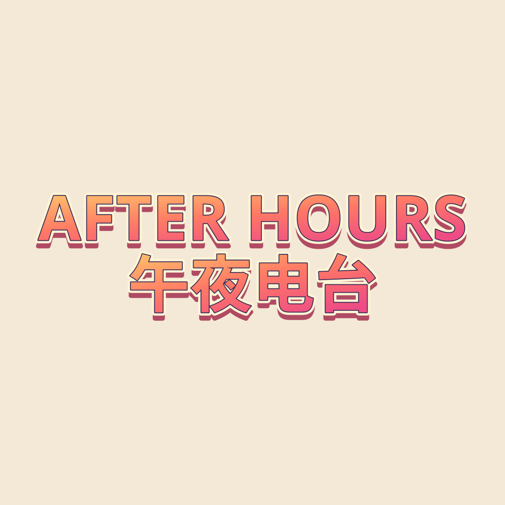

# RetroType Studio

**制作能显示中日韩和混合文字的复古标题图。** 输入文字、调整样式、预览并导出 PNG 或 SVG，不需要账号或 AI 服务。



## 在线使用

**[打开 RetroType Studio](https://lydiatools.github.io/retrotype-studio/)** · [English README](README.md)

## 功能

- 使用浏览器系统字体或本地载入的字体，排版拉丁字母、中文、日文、韩文及混合文字。
- 四种原创文字效果：汽水字、冷光镀铬、套色印刷、夜光信号。
- 选择正方形、横版、竖版画布，设置纯色或透明背景。
- 导出可分享的 PNG，或可继续编辑文字的 SVG。
- 预览和字体文件留在本机浏览器中，不会把文字或字体上传到 AI 服务或服务器。

## 快速开始

打开在线编辑器，修改示例标题，选择效果和画布比例，再导出 PNG 或 SVG。也可以在本地运行：

```bash
python3 -m http.server 4173
```

用浏览器打开 `http://localhost:4173`。

## 字体与导出

编辑器使用当前浏览器可用的字体。如果缺少文字字形或想换字体，可以载入 `.woff`、`.woff2`、`.ttf` 或 `.otf` 文件。字体只在当前浏览器会话中读取，不会上传；超过 12 MB 的文件不接受。

PNG 保留浏览器当前渲染效果。SVG 中的文字仍可编辑，默认按字体名称引用字体。可选择把本地字体嵌入 SVG，但只有字体授权允许嵌入时才能使用。其他设备没有对应字体时，可能会以备用字体显示。

## 无需构建步骤

RetroType Studio 是静态网页工具，不需要包管理器、AI API、分析服务、登录或服务器端字体存储。GitHub Pages 会部署本仓库中的静态文件。

## 项目说明

这是围绕文字系统覆盖和本地字体选择独立实现的项目，不使用 TitleArt 的代码、图片或素材，也不隶属于 Microsoft 或任何字体厂商。仓库不包含字体文件；载入或嵌入字体前请查看字体授权。

## 许可证

源码采用 [MIT 许可证](LICENSE)。源码许可证不包含用户自行载入字体的权利。
